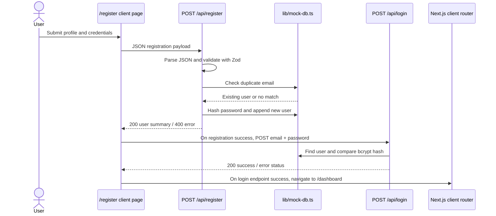
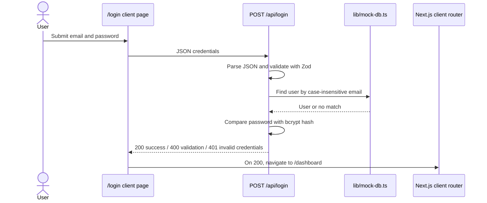
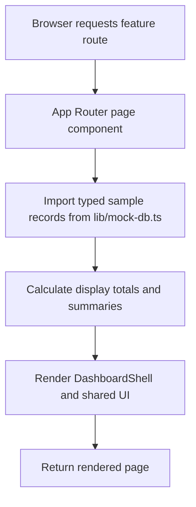

# FitTrack

FitTrack is a personal health and fitness tracking web application. Its App Router UI presents an overview dashboard and focused pages for workouts, hydration, sleep, nutrition, activity, habits, and profile settings. It also includes demo registration and login endpoints, a NextAuth credentials handler, and a Prisma schema describing a planned PostgreSQL data model.

> **Implementation status:** The health pages currently render sample data from `lib/mock-db.ts`. The registration, login, and NextAuth credentials handlers also use that in-memory module; they do not read or write the PostgreSQL database described by `prisma/schema.prisma`. This is a demo/prototype, not a persistent multi-user production application.

## Contents

- [Technology stack](#technology-stack)
- [High-level design](#high-level-design-hld)
- [Application routes](#application-routes)
- [API endpoints](#api-endpoints)
- [Data flows](#data-flows)
- [Low-level design](#low-level-design-lld)
- [Data model](#data-model)
- [Local development](#local-development)
- [Known limitations and production considerations](#known-limitations-and-production-considerations)

## Technology stack

| Area | Technology |
| --- | --- |
| Web framework and routing | Next.js 16 App Router |
| UI | React 19, TypeScript, Tailwind CSS 4 |
| Icons | lucide-react |
| Authentication libraries | NextAuth credentials provider, bcrypt |
| Validation | Zod |
| Database schema (not currently wired to app flows) | Prisma, PostgreSQL |
| Utility styling | clsx, tailwind-merge, class-variance-authority |

## High-level design (HLD)

### System context

```mermaid
flowchart LR
    Visitor[Visitor / user] -->|Browser navigation| Next[Next.js App Router]
    Next --> Pages[Server-rendered page routes]
    Pages --> Shell[DashboardShell and shared UI]
    Pages --> Samples[lib/mock-db.ts sample data]
    Browser[Browser client components] -->|POST JSON| LoginAPI[/api/login]
    Browser -->|POST JSON| RegisterAPI[/api/register]
    LoginAPI --> SampleUsers[In-memory mockUsers]
    RegisterAPI --> SampleUsers
    Browser -->|NextAuth protocol| AuthAPI[/api/auth/*]
    AuthAPI --> SampleUsers
    Browser -->|fittrack-theme localStorage| Theme[ThemeToggle]
    PrismaSchema[prisma/schema.prisma] -. described schema only .-> PostgreSQL[(PostgreSQL)]
```

The dotted Prisma-to-PostgreSQL connection is **not active in the current request flows**. There is no Prisma client usage in the page or API implementations.

### Main components

1. **App Router pages (`app/`)**
   - `/` is the public landing page.
   - `/login` and `/register` are client-side forms that call the corresponding JSON endpoints.
   - `/dashboard` and the health feature routes render the dashboard shell and feature summaries.
   - Pages use static/sample records; the feature pages do not call resource APIs.

2. **Shared dashboard shell (`components/dashboard-shell.tsx`)**
   - Adds desktop sidebar navigation, a page header, theme control, and mobile horizontal navigation.
   - Provides a common layout for the health feature pages.

3. **Shared UI (`components/ui/`)**
   - Reusable buttons, cards, labels, inputs, textareas, badges, and separators.
   - `lib/utils.ts` provides `cn`, which combines conditional classes and resolves Tailwind class conflicts.

4. **Authentication routes (`app/api/`)**
   - `/api/login` and `/api/register` are custom JSON route handlers.
   - `/api/auth/[...nextauth]` exposes NextAuth's credentials/session protocol.
   - All three currently look users up in the same process-local mock module.

5. **Sample data (`lib/mock-db.ts`)**
   - Provides typed sample health records, demo user data, and helper functions for user lookup and registration.
   - `registerUser` mutates the module-level `mockUsers` array; it is not durable storage.

6. **Prisma schema (`prisma/schema.prisma`)**
   - Defines PostgreSQL models for users and health records.
   - Documents the intended relational shape, but no current page or handler uses it.

### Request/rendering architecture

Most feature pages are server components that import sample data and render it directly. Login and registration are client components because they manage form state, submit fetch requests, display errors, and navigate after success. The theme toggle is also a client component; it updates the root `.dark` class and stores the preference in browser local storage.

## Application routes

| Route | Purpose | Data source / behavior |
| --- | --- | --- |
| `/` | Landing page with feature preview and calls to action | Static presentation |
| `/login` | Demo sign-in form | Sends `POST /api/login`, then navigates to `/dashboard` on success |
| `/register` | Account/profile registration form | Sends `POST /api/register`, then sends `POST /api/login`, then navigates to `/dashboard` |
| `/dashboard` | Summary metrics, charts, reminders, and recent records | `lib/mock-db.ts` |
| `/workouts` | Workout sessions, exercises, weekly summary | `lib/mock-db.ts` |
| `/water` | Hydration total, progress display, quick-add UI, history | `lib/mock-db.ts`; quick-add controls are presentation-only |
| `/sleep` | Sleep trend and recent sleep sessions | `lib/mock-db.ts` |
| `/nutrition` | Calorie/macronutrient summary and meals | `lib/mock-db.ts` |
| `/activity` | Daily activity summary and activity records | `lib/mock-db.ts` |
| `/habits` | Habit streaks and completion rates | `lib/mock-db.ts` |
| `/profile` | Demo profile summary and settings form | `lib/mock-db.ts`; settings form is presentation-only |

The dashboard links are currently navigable without authentication middleware. A successful response from the custom login endpoint does not itself protect or authorize the dashboard routes.

## API endpoints

### `POST /api/register`

Creates a demo user in the process-local `mockUsers` array.

**Request JSON**

```json
{
  "name": "Ava Thompson",
  "email": "ava@example.com",
  "password": "password123",
  "dateOfBirth": "1996-08-14",
  "height": 170,
  "initialWeight": 69,
  "preferredUnits": "metric",
  "goals": ["Build strength", "Improve sleep"],
  "activityPreferences": ["Strength", "Running"]
}
```

`goals` and `activityPreferences` default to empty arrays when omitted. `name` must contain at least two characters; email must be valid; password must contain at least eight characters; height and initial weight must be positive numbers; and `preferredUnits` must be `metric` or `imperial`. `dateOfBirth` is validated only as a string.

**Responses**

| Status | Body |
| --- | --- |
| `200` | `{ "ok": true, "user": { "id": "...", "name": "...", "email": "..." } }` |
| `400` | `{ "error": { ... } }` for Zod validation errors; duplicate email and caught handler errors are also returned as `{ "error": "..." }` |

The implementation hashes a new password with bcrypt before storing the user in memory. An app/process restart discards users created this way.

### `POST /api/login`

Checks credentials against `findUserByEmail` from the in-memory sample module and compares the submitted password with the stored bcrypt hash.

**Request JSON**

```json
{
  "email": "demo@fittrack.app",
  "password": "demo123"
}
```

The email must be valid and the password must contain at least eight characters.

**Responses**

| Status | Body |
| --- | --- |
| `200` | `{ "ok": true, "user": { "id": "...", "email": "...", "name": "..." } }` |
| `400` | `{ "error": { ... } }` for validation errors |
| `401` | `{ "error": "Invalid credentials" }` when the user is not found or the password does not match |
| `500` | `{ "error": "..." }` for unexpected errors caught by the handler |

This endpoint returns a JSON success response; it does not create a NextAuth session or set an authentication cookie.

### `/api/auth/[...nextauth]`

The catch-all route is handled by NextAuth using the credentials provider and JWT sessions.

| Method | Purpose |
| --- | --- |
| `GET` | NextAuth session and provider/callback protocol endpoints |
| `POST` | NextAuth sign-in, callback, and sign-out protocol endpoints |

The credentials provider accepts `email` and `password`, checks the same in-memory user list, and compares the bcrypt hash. Its sign-in page is configured as `/login`. The exact subpaths and payloads are NextAuth protocol endpoints rather than custom FitTrack JSON contracts.

> The current login and registration forms call `/api/login`, not the NextAuth sign-in protocol. Consequently, those form submissions do not establish the JWT session provided by `/api/auth/[...nextauth]`.

### Unsupported API routes

There are no current REST endpoints for creating, listing, updating, or deleting workouts, meals, sleep records, habits, water entries, body measurements, or activity logs. The corresponding UI pages render sample data, and apparent controls such as water quick-add and profile save do not persist changes.

## Data flows

### Registration



Registration and the follow-up login are two separate requests. The second request only verifies credentials; it does not establish a NextAuth session.

### Login



### Feature page rendering



This is currently a read-only display flow. Feature pages do not call an API or persist interactions.

### Theme preference

1. On mount, `ThemeToggle` reads `fittrack-theme` from `localStorage`.
2. If there is no saved value, it uses `prefers-color-scheme`.
3. It applies/removes the `dark` class on the root `<html>` element.
4. Clicking the toggle applies the new class immediately, stores `dark` or `light`, and notifies the mounted toggle through a custom browser event.
5. Tailwind's custom `dark` variant styles descendants of `.dark`.

## Low-level design (LLD)

### Route and component structure

```text
app/
  layout.tsx                   Root document, Geist fonts, metadata, global CSS
  page.tsx                     Public landing page
  login/page.tsx               Client login form
  register/page.tsx            Client registration form
  dashboard/page.tsx           Overview dashboard
  workouts/page.tsx            Workout history and summary
  water/page.tsx               Hydration progress and history
  sleep/page.tsx               Sleep trends and sessions
  nutrition/page.tsx            Meal and macro summaries
  activity/page.tsx            Activity records and summary
  habits/page.tsx              Habit completion overview
  profile/page.tsx             Demo profile and settings form
  api/
    login/route.ts              Custom credential verification
    register/route.ts           Custom in-memory registration
    auth/[...nextauth]/route.ts NextAuth credentials/session handler
components/
  dashboard-shell.tsx          Shared responsive health-app frame/navigation
  theme-toggle.tsx             Client-side persisted theme preference
  ui/                          Reusable presentational components
lib/
  mock-db.ts                   Typed sample data and in-memory user helpers
  utils.ts                     Tailwind class merge helper
prisma/
  schema.prisma                PostgreSQL-oriented model definitions
```

### Authentication responsibilities

- **Validation:** Zod schemas are declared in the route handlers and validate parsed request JSON.
- **Registration:** `registerUser` performs a case-insensitive duplicate check, hashes the password using bcrypt cost factor 10, creates a generated `user-${Date.now()}` ID, and appends the user to the module-level array.
- **Custom login:** `POST /api/login` finds the user by case-insensitive email and verifies the password with bcrypt's asynchronous `compare`.
- **NextAuth login:** `CredentialsProvider.authorize` repeats the lookup and password comparison for NextAuth sign-in requests.
- **Session:** NextAuth is configured to use JWT strategy. This is separate from the custom JSON login API.

### Error behavior

- Zod errors use `error.flatten()` and are returned as JSON with HTTP `400`.
- Invalid or unknown custom login credentials return the same `401` response.
- Registration catches errors, including the duplicate-user error, and returns `400`.
- The custom login handler catches unexpected exceptions and returns `500`.
- The client forms display an error message for non-success responses. They do not currently use a shared API client.

## Data model

`prisma/schema.prisma` declares the following PostgreSQL entities. They describe the intended persistence model, not the current runtime store.

| Model | Important fields | Relationships |
| --- | --- | --- |
| `User` | Name, unique email, password hash, date of birth, height, initial weight, preferred units, theme, timestamps | One-to-many to each user-owned health record below |
| `Workout` | Title, category, duration, notes, date, user ID | Belongs to `User`; has many `Exercise` records |
| `Exercise` | Name, sets, reps, optional weight, workout ID | Belongs to `Workout` |
| `Meal` | Name, meal type, quantity, calories, protein, carbohydrates, fats, consumed time, user ID | Belongs to `User` |
| `SleepRecord` | Sleep start/end, quality, notes, user ID | Belongs to `User` |
| `Habit` | Title, description, frequency, streak, completion rate, user ID | Belongs to `User`; has many `HabitCompletion` records |
| `HabitCompletion` | Date, completed flag, habit ID | Belongs to `Habit` |
| `WaterEntry` | Amount in millilitres, date, user ID | Belongs to `User` |
| `BodyMeasurement` | Date, weight, optional waist/chest/notes, user ID | Belongs to `User` |
| `ActivityLog` | Date, type, steps, optional distance, active minutes, calories, user ID | Belongs to `User` |

The schema uses CUID primary keys, PostgreSQL as the datasource, and `DATABASE_URL` as the connection string. User email is unique. Most categorical values are represented as strings rather than Prisma enums. The existing app does not currently run migrations, instantiate Prisma Client, or enforce this schema in its mock data.

## Local development

### Requirements

- Node.js compatible with the project's Next.js 16 and package versions
- npm

### Install and run

```bash
npm install
npm run dev
```

Open [http://localhost:3000](http://localhost:3000).

### Available scripts

| Command | Purpose |
| --- | --- |
| `npm run dev` | Start the Next.js development server |
| `npm run build` | Create and type-check the production build |
| `npm run start` | Serve the production build |
| `npm run lint` | Run ESLint |

### Demo credentials

The sample user in `lib/mock-db.ts` is:

```text
Email:    demo@fittrack.app
Password: demo123
```

These are demo credentials only. Do not reuse them for real accounts or production systems.

### Environment variables and database

The Prisma datasource expects `DATABASE_URL`. NextAuth reads `NEXTAUTH_SECRET`, but the current configuration falls back to a hard-coded development secret if that variable is unset. No database connection is required by the currently wired mock-data flows. Before using this app outside local/demo work:

1. Configure a strong `NEXTAUTH_SECRET` through the deployment environment.
2. Replace the hard-coded secret fallback.
3. Wire Prisma Client into authentication and feature data access.
4. Create and apply database migrations.
5. Remove demo credentials and use persistent, per-user storage.

Do not commit real secrets or database credentials.

## Known limitations and production considerations

- **Volatile state:** users registered at runtime exist only in the current Node.js process and are lost on restart; state is not shared across instances.
- **Demo health data:** feature pages read fixed sample data and do not filter by authenticated user.
- **No health-record write APIs:** add, save, and quick-add UI affordances are not connected to persistent mutations.
- **Authentication mismatch:** custom login returns JSON without setting a session; the NextAuth session protocol is implemented separately and is not used by the forms.
- **No route protection:** dashboard and feature routes are directly accessible without a verified session.
- **Prisma is not integrated:** the schema does not currently back the API routes or rendered pages.
- **Production hardening required:** use a managed persistent database, production secrets, authorization checks, rate limiting, robust error handling, and a defined account/session lifecycle before deployment.
